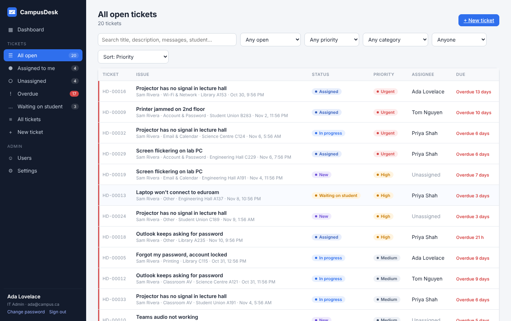
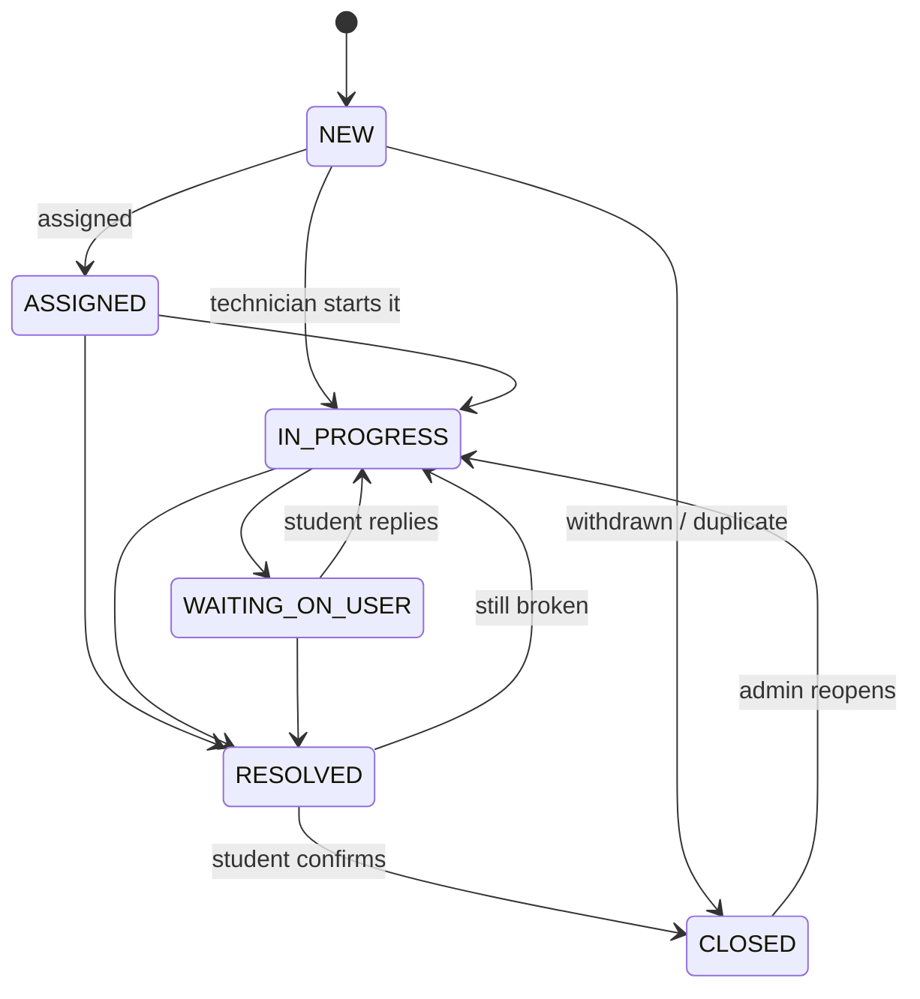
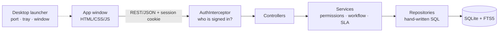

# CampusDesk

**A campus IT help desk: students report problems, IT triages, assigns and resolves them against service-level deadlines.**

Students submit tickets with a title, description, device and location. IT staff see every
ticket in filterable queues, assign them to technicians, set priority and status, talk to the
student or leave internal troubleshooting notes, and record the resolution. A dashboard shows
workload, overdue tickets and SLA performance.

> **Stack:** Java 21 · Spring Boot · SQLite · plain HTML/CSS/JS · packaged as a Windows app with jpackage + Inno Setup



---

## Features

**For students**
- Create an account with a student number, then report a problem: title, category, details, device type, building and room.
- "My tickets" groups open, needs-your-attention (resolved, please confirm) and closed tickets.
- Reply to IT, confirm a fix, reopen if it's still broken, or withdraw a ticket.

**For IT staff**
- Queues: *All open*, *Assigned to me*, *Unassigned*, *Overdue*, *Waiting on student*, with live counts.
- Filter by status, priority, category and assignee. Full-text search over titles, descriptions and messages. Several sort orders.
- Ticket page: status actions, assignment, priority, category, public replies and **internal notes** (never shown to students), plus a timeline of every change.
- **SLA deadlines** per priority (first response + resolution), shown as *On track / Due soon / Overdue / Met / Missed*.
- **Dashboard:** open / unassigned / overdue counts, SLA-met %, average resolution and first-response times, created-vs-resolved chart, open by priority and status, tickets by category, technician workload ranking.

**For admins**
- Manage users (students, technicians, admins): create, edit role, deactivate, reset password.
- Edit SLA targets and ticket categories.

**Roles**

| | Student | Technician | IT Admin |
|---|:-:|:-:|:-:|
| Submit and track own tickets | ✓ | ✓ | ✓ |
| See all tickets, internal notes | | ✓ | ✓ |
| Work tickets assigned to them (status, resolve) | | ✓ | ✓ |
| Take an unassigned ticket | | ✓ | ✓ |
| Assign to anyone, change priority, reopen closed | | | ✓ |
| Users and settings | | | ✓ |

## Ticket lifecycle



The rules live in one table in `TicketWorkflow.java` and are enforced on the server. The UI only
shows the buttons the current user is allowed to press.

## Architecture



| Layer | Package | Role |
|---|---|---|
| Security | `security/` | PBKDF2 password hashing, login throttling, session check, current-user injection |
| Web | `web/` | REST controllers |
| Services | `service/` | Business rules: who may do what, ticket state machine, SLA maths, validation |
| Repositories | `repo/` | All SQL (JdbcTemplate), including the reporting queries |
| Desktop | `desktop/` | Single-instance launcher, app window, tray icon |

## Install (Windows)

**From a release:** download `CampusDesk-Setup-1.0.0.exe` (installer) or `CampusDesk-1.0.0-portable.zip`
(unzip and run `CampusDesk.exe`). Java is bundled, so there's nothing else to install.

> Windows may show "Windows protected your PC" because the app isn't code-signed. Click **More info → Run anyway**.

On first launch you create the **IT admin** account. Then add technicians under *Users*, and
students can create their own accounts from the sign-in screen.

**From source** (needs JDK 21: `winget install EclipseAdoptium.Temurin.21.JDK`):

```powershell
cd backend
powershell -ExecutionPolicy Bypass -File .\run.ps1                # run it
powershell -ExecutionPolicy Bypass -File .\run.ps1 test           # run the tests
powershell -ExecutionPolicy Bypass -File .\build-installer.ps1    # build the app + installer
```

The scripts download Maven into `backend\.tools` the first time. For the installer `.exe`,
install Inno Setup once: `winget install JRSoftware.InnoSetup`.

Data lives in `%LOCALAPPDATA%\CampusDesk\data\campusdesk.db`. The server only listens on
`127.0.0.1`. Closing the window keeps CampusDesk in the system tray; use tray → **Quit** to stop it.

## Security notes

- Passwords are hashed with **PBKDF2-HMAC-SHA256** (600,000 iterations, random salt per user), never stored in plain text.
- **5 failed sign-ins** for an email locks it for 10 minutes.
- A new session id is issued at sign-in (**session fixation** protection). The cookie is `HttpOnly` and `SameSite=Strict` (**CSRF** protection).
- Every permission check happens on the **server**. Students get *404* for tickets that aren't theirs, so they can't even confirm the ticket exists.
- Internal notes are filtered out **in the SQL query** for students, so they never leave the database.
- Accounts are deactivated, never deleted, so ticket history stays intact. The last active admin can't be removed.

## Project structure

```
backend/
  src/main/java/com/campusdesk/
    security/   PasswordHasher, LoginThrottle, AuthInterceptor, CurrentUser
    model/      records + enums: Ticket, User, Comment, TicketStatus, Priority, SlaPolicy …
    repo/       SQL: tickets, comments, users, settings, dashboard, search index
    service/    TicketService, TicketWorkflow (state machine), SlaCalculator, AuthService …
    web/        REST controllers
    desktop/    launcher, window, tray
  src/main/resources/  schema.sql, static/ (UI)
  src/test/java/       workflow, SLA and security tests
  packaging/  common.ps1, campusdesk.iss, campusdesk.ico
  run.ps1, build-installer.ps1
docs/LEARNING.md   how the Java + SQL parts work
```

## Roadmap

- Business-hours SLAs that pause while *Waiting on student*
- Email notifications
- File attachments (screenshots of error messages)
- Multi-PC mode (server on one machine, browsers on the campus network) with HTTPS

## License

MIT
